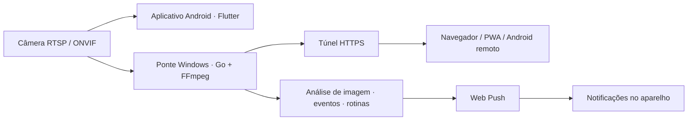

# Ninho Monitor

**Monitoramento pessoal com Android, navegador e uma ponte Windows.**

Um projeto que conecta uma câmera RTSP/ONVIF a um visualizador próprio, inclusive no iPhone, com histórico de eventos, notificações de movimento e rotinas de acompanhamento.

## Funcionalidades

- Vídeo local no Android e acesso remoto por navegador/PWA.
- Conversão de HEVC/G.711 para H.264/AAC no notebook, com distribuição HLS.
- Controle por setas ou joystick, com parada ao soltar e limite por gesto.
- Histórico privado de sete dias, com até 300 eventos e sem gravação permanente.
- Modos Casa, Fora e Dormir, com preferências independentes de monitoramento e avisos.
- Automações diárias por horário, executadas no notebook.
- Web Push para movimento e avisos de energia, bateria e perda de imagem.
- Acesso HTTPS com senha remota própria, sem encaminhar portas da câmera no roteador.

## Arquitetura



A ponte compartilha uma conversão de vídeo entre os espectadores. A análise de imagem e as rotinas continuam quando o visualizador está fechado, desde que o notebook permaneça ligado e conectado.

## Tecnologias

| Componente | Tecnologias |
| --- | --- |
| Aplicativo | Flutter, Dart, media_kit, armazenamento seguro |
| Ponte | Go, FFmpeg, RTSP, ONVIF, SOAP |
| Visualizador | HTML, CSS, JavaScript, HLS, service worker |
| Notificações | Web Push, VAPID, mensagens criptografadas |
| Acesso remoto | Tailscale Funnel ou túnel temporário Cloudflare |
| Proteção | Sessões, CSRF, PBKDF2, DPAPI no Windows |

## Código e versões

| Diretório | Conteúdo |
| --- | --- |
| `apps/android/` | Aplicativo Flutter 2.5.0, build 17; projetos Android/iOS, testes e design |
| `bridge/` | Ponte Windows 1.4.0, visualizador web incorporado e testes Go |
| `website/` | Código do site de download e guias; binários de distribuição não incluídos |
| `legacy/web-bridge/` | Protótipo JavaScript anterior, preservado como referência |
| `docs/` | Restauração, diretrizes de design e inventário de integridade |

O nome do projeto é **Ninho Monitor**. Alguns identificadores internos, nomes de executáveis e diretórios de dados foram mantidos para compatibilidade com instalações existentes. O backup e esta publicação não alteram os aplicativos instalados.

## Executar e compilar

Consulte [o guia de restauração](docs/RESTORE.md) para instalar as ferramentas, compilar Android e Windows e obter os componentes externos.

Para testar a ponte, com Go >=1.26:

```sh
cd bridge
go test -race ./...
```

Para preparar o aplicativo, com Flutter compatível com Dart >=3.10:

```sh
cd apps/android
flutter pub get
flutter test
```

O acesso atual no iPhone usa a PWA. Os arquivos iOS estão preservados, mas não há IPA distribuído neste repositório.

## Validação e limites

O aplicativo passou em 121 testes Flutter. A ponte passou em 24 testes Go com detector de races e tem validações com câmera sintética no Chromium. Os casos incluem autenticação, negociação RTSP, interrupção de controle, eventos, rotinas, energia simulada e criptografia de push. Os detalhes e os limites estão em [bridge/VALIDACAO.md](bridge/VALIDACAO.md).

Testes sintéticos não substituem a conferência da câmera, da bateria Windows ou da entrega de notificações em aparelhos reais. A análise identifica mudanças na imagem; não determina se uma criança acordou nem avalia sono, respiração ou saúde. Avisos podem atrasar. Se o notebook desligar ou ficar totalmente sem internet, a própria ponte não consegue enviar uma notificação.

## Privacidade

Este é um repositório público de código, com exemplos de rede fictícios. Senhas, configurações reais de câmera, assinaturas push, histórico de uso, endereços remotos pessoais e chaves de assinatura ficam fora do Git. O acesso ao código não concede acesso a uma câmera ou à hospedagem privada do proprietário.

## Dependências

As licenças e os créditos das dependências foram preservados. O código próprio está sob a [licença MIT](LICENSE). Bibliotecas e componentes de terceiros mantêm suas próprias licenças.
