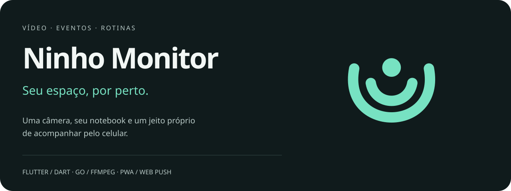
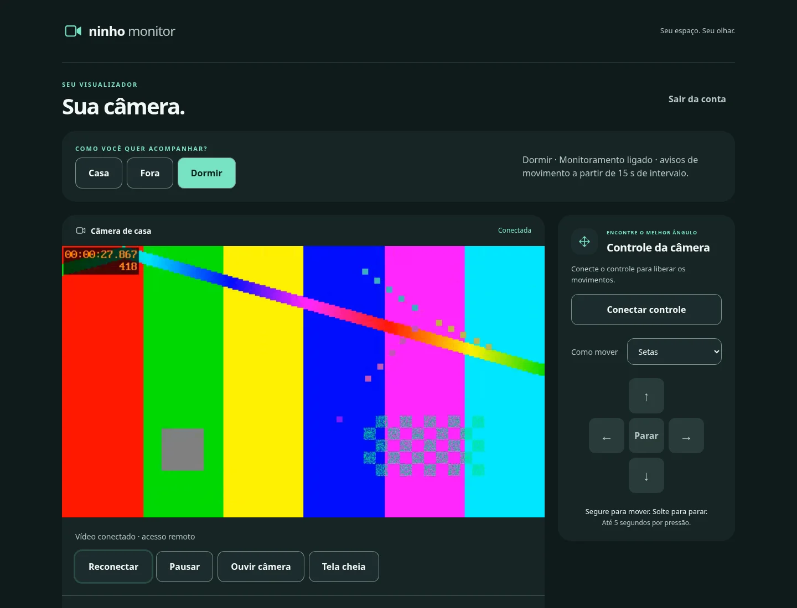
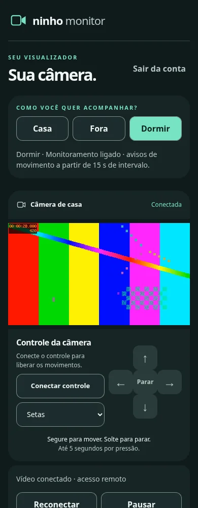
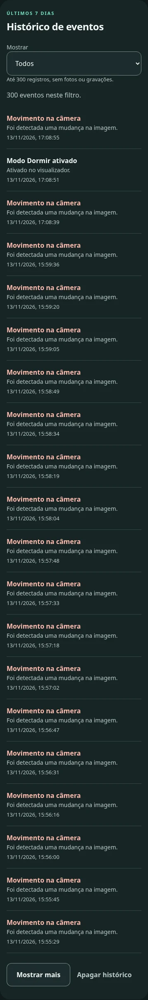
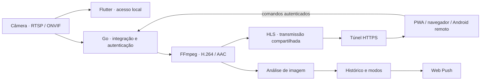

<p align="center"></p>

<p align="center">
  <a href="https://github.com/alejandroBR17/ninho-monitor/actions/workflows/ci.yml"></a>
  &nbsp; <a href="LICENSE">Licença MIT</a> · <a href="docs/CASE-STUDY.md">Estudo de caso</a> · <a href="docs/ARCHITECTURE.md">Arquitetura</a> · <a href="docs/DEMO.md">Executar a demonstração</a>
</p>

**Uma câmera RTSP/ONVIF existente, um notebook Windows como ponte e uma interface própria no Android e no iPhone.** O Ninho Monitor integra reprodução de vídeo, controle de movimento, eventos e automações, sem exigir outro aplicativo de câmera no iPhone.

## O problema que o projeto resolve

Uma câmera que já funcionava na rede local precisava ser acessada pelo Android e pelo navegador do iPhone. O firmware respondia a parte do ONVIF, mas recusava consultas de capacidades e não seguia integralmente a negociação esperada pelo reprodutor. O vídeo HEVC também precisava chegar ao navegador em outro formato.

A implementação separou essas responsabilidades: cliente Android para acesso local, ponte Go para integrar a câmera e uma PWA que recebe vídeo compatível, controles e eventos. O notebook mantém a análise e as rotinas mesmo com a página fechada.

## Em uso



| Celular | Histórico de eventos |
| --- | --- |
|  |  |

*Capturas da interface executando com uma fonte RTSP sintética. Nenhuma imagem doméstica, credencial ou dado real de monitoramento foi usado. O controle físico não é validado por essa demonstração.*

## O que vale olhar no código

| Desafio | Implementação | Evidência |
| --- | --- | --- |
| Firmware com negociação RTSP incompleta | Normalização de transporte restrita aos canais intercalados solicitados; preservação do RTP | [Ponte RTSP](bridge/rtsp.go) · [testes](bridge/rtsp_test.go) |
| HEVC e áudio incompatíveis com o navegador | Conversão compartilhada no notebook para H.264/AAC e distribuição HLS | [Gerenciamento da transmissão](bridge/stream.go) |
| Movimento que não pode ficar enfileirado | Última direção substitui a anterior; parada no cancelamento, perda de heartbeat e limite por gesto | [Controle PTZ](bridge/motion.go) · [testes](bridge/motion_test.go) |
| Playlist que desaparece após inatividade | Renovação da visualização e recuperação limitada; pausa manual respeitada | [Reprodutor web](bridge/web/app.js) · [ciclo de vida](bridge/viewer_lifecycle_test.go) |
| Alertas com o visualizador fechado | Análise de imagem no notebook, histórico limitado, Web Push e rotinas locais | [Eventos e push](bridge/alerts.go) · [modos e rotinas](bridge/home.go) |
| Informações de câmera fora do navegador | Configuração local, armazenamento DPAPI e acesso remoto por sessão autenticada | [Servidor](bridge/server.go) · [integração Windows](bridge/platform_windows.go) |

## Recursos implementados

- **Vídeo:** acesso local no Android e remoto por navegador/PWA, com retomada após interrupções temporárias.
- **Controle:** setas ou joystick, parada ao soltar e limite local de cinco segundos por gesto.
- **Eventos:** histórico privado de sete dias, até 300 registros, filtros e exclusão, sem gravação permanente.
- **Modos:** Casa, Fora e Dormir com sensibilidade e notificações configuráveis.
- **Automações:** até oito rotinas diárias, executadas no horário do notebook.
- **Continuidade:** avisos de energia, bateria baixa, perda de imagem e recuperação.
- **iPhone:** instalação pela Tela de Início e Web Push em versões compatíveis do iOS.

## Arquitetura



**Flutter/Dart** no aplicativo, **Go** na ponte, **FFmpeg** na conversão e **HTML/CSS/JavaScript** no visualizador. O acesso remoto usa Tailscale Funnel ou Cloudflare Quick Tunnel. [Veja os fluxos, limites e decisões de arquitetura →](docs/ARCHITECTURE.md)

## Rodar sem uma câmera física

A [demonstração reproduzível](docs/DEMO.md) usa uma fonte sintética local. Para os testes automatizados:

```sh
# Ponte · Go >= 1.26
cd bridge
go test -race ./...
```

```sh
# Aplicativo · Flutter 3.47.9 / Dart compatível
cd apps/android
flutter pub get
flutter test
```

Para compilar os aplicativos e configurar uma câmera real, consulte o [guia de restauração e instalação](docs/RESTORE.md).

## Qualidade e limites de validação

**121 testes Flutter e 24 testes Go** passaram na preparação pública do projeto. O [workflow de CI](.github/workflows/ci.yml) executa as duas suítes; o badge no topo mostra o resultado real do GitHub Actions. A suíte Go usa o detector de races. Há verificações adicionais de navegador com vídeo sintético e de criptografia Web Push.

Os testes de laboratório não comprovam movimento físico, áudio audível, bateria Windows ou entrega de notificações em um iPhone real. Os detalhes estão em [PUBLIC-VALIDATION.md](docs/PUBLIC-VALIDATION.md) e [bridge/VALIDACAO.md](bridge/VALIDACAO.md).

A análise identifica mudança na imagem, sem determinar se uma criança acordou ou avaliar sono, respiração ou saúde. A transmissão pode ter atraso. Se o notebook desligar ou perder toda a internet, ele não consegue enviar um alerta sobre a própria indisponibilidade.

## Organização

```text
apps/android/       Aplicativo Flutter 2.5.0 · build 17
bridge/             Ponte Go 1.4.0 e visualizador web incorporado
website/            Código do site de download e guias
legacy/web-bridge/   Protótipo JavaScript anterior
.github/workflows/  Testes automatizados
docs/              Estudo de caso, arquitetura, demonstração e restauração
```

Os nomes visíveis da versão web usam Ninho Monitor. Identificadores internos e diretórios de dados legados permanecem para compatibilidade. Este repositório não publica atualizações nos aplicativos instalados nem expõe a hospedagem privada de download.

## Próximos passos

- Monitor independente da ponte, capaz de detectar um desligamento total do notebook.
- Região de interesse para reduzir alertas de movimento fora da área acompanhada.
- Mais câmeras e automações por dia da semana.

Esses itens ainda não estão implementados. Sugestões e contribuições seguem o [guia de contribuição](CONTRIBUTING.md).

## Licença e dependências

O código próprio está sob a **[licença MIT](LICENSE)** — copyright de [alejandroBR17](https://github.com/alejandroBR17). Bibliotecas, componentes e arquivos de terceiros mantêm suas licenças originais; veja [THIRD-PARTY-NOTICES.md](THIRD-PARTY-NOTICES.md).
