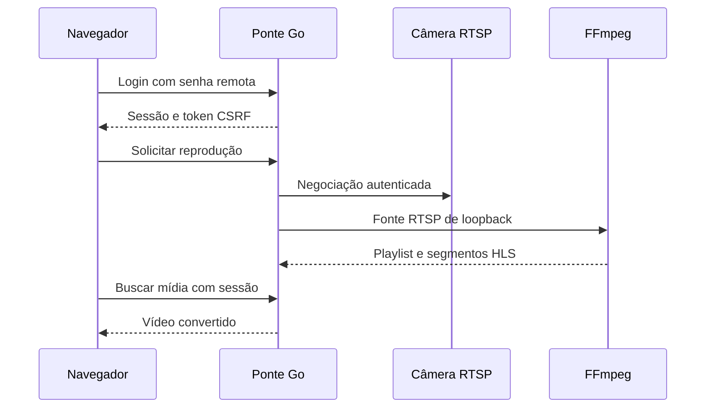

# Arquitetura e fronteiras do sistema

## Componentes

| Componente | Responsabilidade | Estado que mantém |
| --- | --- | --- |
| Flutter | Reprodução local, descoberta e controle; acesso ao visualizador remoto | Preferências e dados protegidos do aplicativo |
| Servidor Go | Sessões, ponte RTSP, HTTP e coordenação do controle | Configuração protegida e sessões temporárias |
| FFmpeg | Conversão compartilhada para HLS e quadros reduzidos para análise | Segmentos temporários de transmissão |
| Análise e rotinas | Mudanças de imagem, modos, eventos e horários | Histórico limitado e preferências |
| PWA | Reprodução, controles, configuração e apresentação de eventos | Casca estática; sem cache de vídeo |
| Service worker | Recepção de Web Push e abertura da própria origem | Assinatura autorizada pelo usuário |

## Fluxo de vídeo remoto

Credenciais da câmera ficam no notebook, em vez de serem colocadas na URL enviada ao navegador ou na linha de comando do FFmpeg. A câmera e o cliente remoto não se conectam diretamente no fluxo da ponte.

## Fronteiras de acesso

- O servidor escuta em loopback. O túnel expõe o visualizador autenticado, não as portas da câmera.
- No modo de endereço fixo, um listener separado bloqueia o painel local e suas APIs.
- Playlist, segmentos e comandos remotos exigem sessão; escritas verificam origem e CSRF.
- A senha remota é verificada com PBKDF2. O Windows protege os dados locais com DPAPI.
- O service worker armazena apenas a interface estática e não intercepta a mídia para cache.
- A configuração de Web Push valida destinos e preserva as mensagens criptografadas.

Essas são medidas implementadas, não uma declaração de auditoria externa ou ausência de vulnerabilidades.

## Controle PTZ

O coordenador aceita um controlador por vez e mantém a direção mais recente. Cada gesto tem identificação, sequência, heartbeat e limite local. Uma parada pendente não deve ser descartada por um gesto novo. A interface também para ao perder foco, cancelar um ponteiro ou mudar de layout.

Os limites dependem de rede e firmware. Uma resposta SOAP não mede o deslocamento físico.

## Eventos e energia

A análise recebe quadros reduzidos em memória, filtra variação uniforme de brilho, aquece antes de avaliar movimento e reduz repetições por intervalo. Comandos de giro suprimem temporariamente a análise para reduzir falsos positivos.

Modos e rotinas ficam no notebook. As rotinas seguem seu relógio local e não executam retroativamente horários perdidos. O histórico é limitado a 300 eventos em sete dias e guarda apenas metadados.

Os avisos de saúde observam energia, bateria, espaço disponível e chegada da imagem. O cliente passa a Sem confirmação quando não consegue consultar a ponte. Detectar indisponibilidade total com o cliente fechado ainda requer infraestrutura externa.

## Por que estas escolhas?

| Escolha | Motivo | Custo ou limite |
| --- | --- | --- |
| Ponte no notebook | Reaproveita hardware e traduz os formatos da câmera | Exige notebook ligado e conectado |
| HLS | Compatibilidade com Safari e navegadores com hls.js | Buffer e atraso adicionais |
| Conversão compartilhada | Evita um FFmpeg por espectador | Todos recebem a mesma saída configurada |
| PWA no iPhone | Acesso próprio sem distribuir IPA | Permissões e restrições do iOS |
| Rotinas locais | Não dependem da aba aberta | Usam o horário e a disponibilidade do notebook |
| Dados protegidos localmente | Não exige enviar configuração ou histórico para um servidor de aplicação externo | Backup e continuidade dependem do notebook |
